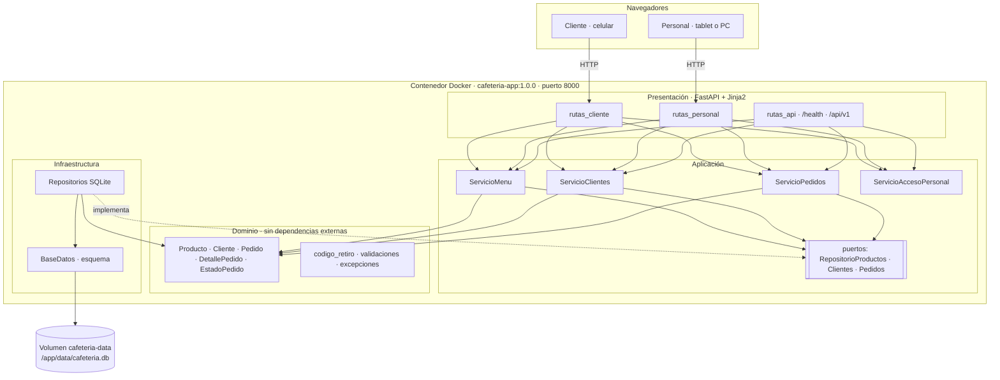
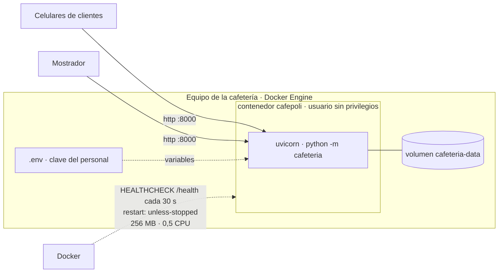
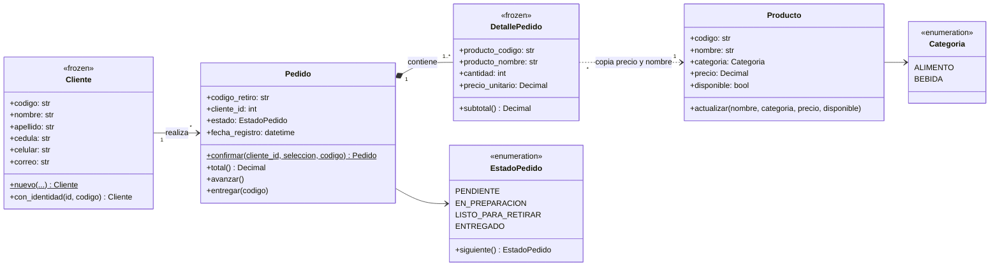
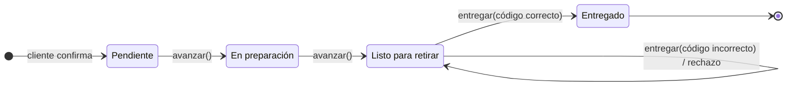
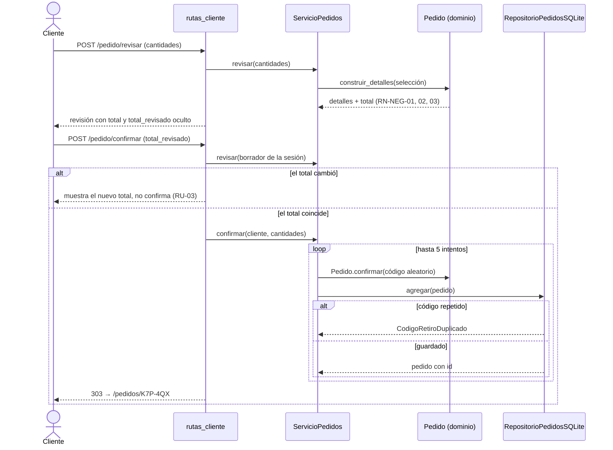
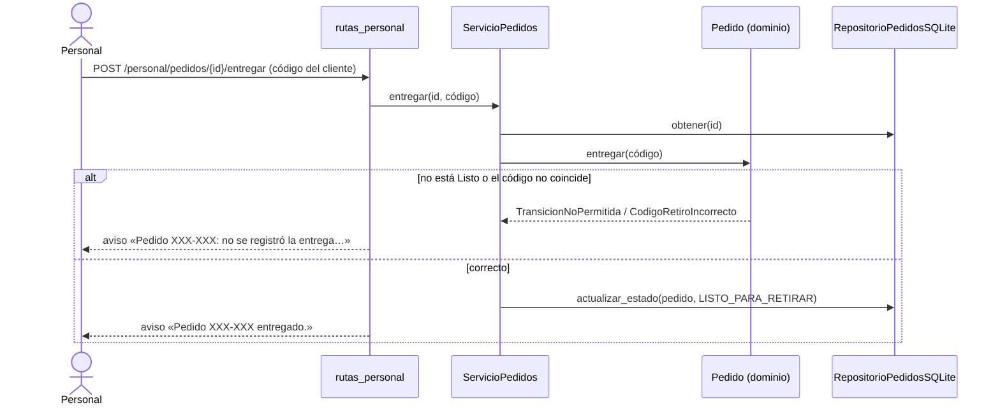
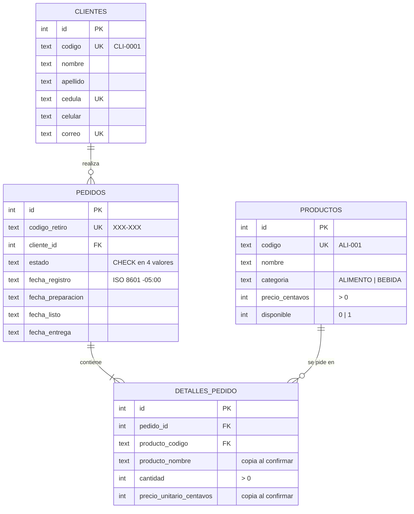

# 2. Documentación de diseño

Arquitectura, diseño detallado y decisiones del Release 1.0. Las decisiones con sus alternativas y
consecuencias están en los [ADR](adr.md).

## 2.1 Arquitectura de alto nivel

CaféPoli es una aplicación web con **arquitectura en capas** (ADR-002). Cada capa solo depende de
la inferior, y la persistencia se invierte con puertos: los servicios dependen de protocolos que la
infraestructura implementa. Las reglas de negocio quedan aisladas en el dominio.

| Capa | Paquete | Responsabilidad | Depende de |
|---|---|---|---|
| Presentación | `cafeteria.presentacion` | Traducir HTTP a llamadas de servicio, sesiones, plantillas, API | Aplicación |
| Aplicación | `cafeteria.aplicacion` | Casos de uso: obtener datos, invocar el dominio, guardar | Dominio y puertos |
| Dominio | `cafeteria.dominio` | Entidades y reglas RN-NEG-01 a 07 | Nada (biblioteca estándar) |
| Infraestructura | `cafeteria.infraestructura` | SQLite, repositorios, menú de demostración | Dominio y puertos |

**Por qué en capas.** Pressman identifica las capas (*layering*) como la clave de la abstracción:
separan los conceptos del diseño de los detalles de implementación y reducen la complejidad [1].
En la práctica, la regla RN-NEG-07 vive en `Pedido.entregar` y se prueba sin servidor ni base de
datos. La semana 4 advierte sobre *Feature Envy* y *Shotgun Surgery*: si las reglas se repartieran
entre rutas y plantillas, un cambio de regla obligaría a tocar muchos archivos [2], [3].

## 2.2 Despliegue

## 2.3 Modelo de dominio

Decisiones que previenen *code smells* desde el diseño (semana 4 [6], Fowler [3]):

| Riesgo | Decisión | Refactorización de referencia |
|---|---|---|
| *Primitive Obsession*: estado como texto, dinero como `float` | `EstadoPedido` y `Categoria` son enumeraciones; montos con `Decimal` | Replace Primitive with Object |
| *Mutable Data*: el precio del pedido cambia con el menú | `DetallePedido` congelado, sin *setters* (RN-NEG-04) | Remove Setting Method |
| Total guardado que se desincroniza | `Pedido.total` se calcula desde los detalles (RN-NEG-03) | Replace Derived Variable with Query |
| *Data Clumps*: datos del cliente sueltos | Entidad `Cliente` con fábrica validada | Introduce Parameter Object |
| Condicional largo para los estados | Tabla `_SIGUIENTE_ESTADO` | Decompose Conditional |
| `None` revisado en cada llamada | Excepciones de negocio (`PedidoNoEncontrado`) | Introduce Special Case |
| Suposiciones implícitas | Validación en constructores y fábricas | Introduce Assertion |

## 2.4 Ciclo de vida del pedido

Cualquier otra transición (saltar un estado, retroceder, avanzar desde Listo sin código o cambiar un
pedido entregado) lanza `TransicionNoPermitida`. El repositorio guarda el cambio con la condición
`WHERE estado = <estado anterior>` (control optimista): si otra persona ya lo cambió, el segundo
cambio se rechaza (ADR-005).

## 2.5 Secuencias

### PN-01 · Confirmar un pedido

### PN-02 · Entregar un pedido

## 2.6 Modelo de datos

Los montos se guardan como centavos enteros para evitar errores de redondeo; las fechas, en ISO 8601
con zona horaria, para que se comparen correctamente como texto. Las restricciones `UNIQUE` y
`CHECK` repiten en la base de datos las reglas más críticas (código único, estados válidos,
cantidades positivas) como segunda barrera.

## 2.7 Interfaces

**Web.** Páginas renderizadas en el servidor (Jinja2) con mejora progresiva (ADR-008): sin
JavaScript la aplicación funciona igual, y el script solo agrega el total en vivo y la recarga del
tablero. El diseño visual parte de la propuesta estética del equipo:

- Paleta café (`#7B4B2A`) sobre fondo neutro, con cuatro colores de estado separados del color de
  marca: ámbar, azul, verde y gris. Todos tienen contraste ≥ 5,5:1.
- Tipografías Space Grotesk, Inter y JetBrains Mono (licencia OFL), servidas por la propia app.
- El cliente usa primero el celular; el personal trabaja en un tablero tipo kanban.

**API.** `GET /health` y `GET /api/v1/productos?disponibles=true`, documentadas con OpenAPI en
`/docs` ([documentación técnica](../04-documentacion-tecnica/README.md)).

**Rutas web.**

| Rol | Ruta | Propósito |
|---|---|---|
| Cliente | `GET /` · `POST /pedido/revisar` · `POST /pedido/confirmar` | Menú, revisión y confirmación |
| Cliente | `GET /pedidos/{código}` · `GET /mis-pedidos` | Seguimiento |
| Cliente | `GET/POST /registro` · `GET/POST /ingresar` · `POST /salir` | Cuenta |
| Personal | `GET /personal` · `POST /personal/pedidos/{id}/avanzar` · `.../entregar` | Tablero y atención |
| Personal | `GET/POST /personal/menu` · `GET/POST /personal/menu/{código}` · `.../disponibilidad` | Menú |
| Personal | `GET/POST /personal/ingresar` · `POST /personal/salir` | Acceso |
