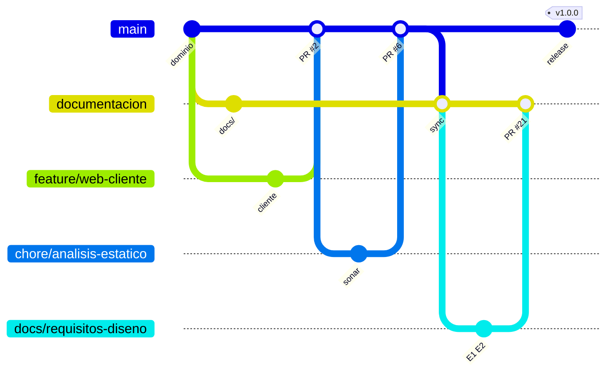

# Flujo de trabajo y gestión de la configuración

## 3.6 Estrategia de ramificación

Se usa **GitHub Flow** [10], el flujo de la semana 5: Issue → rama → commits → Pull Request →
revisión y pruebas → merge. Se adapta con una rama de larga vida para la documentación, como
piden las indicaciones del proyecto (ADR-007).

| Rama | Vida | Nace de | Se integra en | Regla |
|---|---|---|---|---|
| `main` | Permanente | — | — | Código estable y desplegable; protegida: PR y CI en verde |
| `documentacion` | Permanente | `main` | — | Entregables `docs/`; se sincroniza con `main` en cada línea base |
| `feature/<tema>` | Corta | `main` | `main` | Una historia o grupo de historias |
| `fix/<DEF-XX>` | Corta | `main` | `main` | Un defecto, con su prueba de regresión |
| `chore/<tema>` | Corta | `main` | `main` | Configuración, plantillas, análisis |
| `hotfix/<tema>` | Corta | etiqueta `vX.Y.Z` | `main` | Corrección urgente de una versión publicada |
| `docs/<tema>` | Corta | `documentacion` | `documentacion` | Un grupo de entregables |

**Commits.** Pequeños, con un título en español que describe el cambio y un cuerpo con el detalle.
El uso del agente de IA se declara en el informe del proyecto; los commits hasta el PR #21 lo
registran además con la línea `Co-Authored-By`.

**Pull Requests.** Plantilla con el objetivo, la Issue vinculada, los cambios, la evidencia de
pruebas y la definición de terminado de la semana 5 [6]. Se integran con *merge commit*, para
conservar en la historia qué commits formaron cada cambio, y la rama se borra.

## 3.7 Evidencia del Release 1.0

| PR | Rama | Contenido | CI |
|---|---|---|---|
| [#1](../../../../pull/1) | `feature/persistencia-servicios` | Servicios y SQLite (HU-01 a HU-11, capa de datos) | Sin CI (aún no existía) |
| [#2](../../../../pull/2) | `feature/web-cliente` | Interfaz del cliente, API y configuración | Sin CI |
| [#3](../../../../pull/3) | `feature/web-personal` | Interfaz del personal; corrige DEF-02 y DEF-03 | Sin CI |
| [#4](../../../../pull/4) | `feature/docker-ci` | Docker, Compose y CI; corrige DEF-01 | ✅ |
| [#5](../../../../pull/5) | `chore/plantillas-colaboracion` | Plantillas de Issue y PR, CONTRIBUTING, CHANGELOG | ✅ |
| [#6](../../../../pull/6) | `chore/analisis-estatico` | SonarQube y correcciones | ✅ en `main` (ver INC-01) |
| [#21](../../../../pull/21) | `docs/requisitos-diseno` | Entregables 1 y 2 | ✅ |

Las historias de usuario están registradas como Issues [#7 a #17](../../../../issues?q=label%3A%22historia+de+usuario%22)
y los defectos como [#18 a #20](../../../../issues?q=label%3Adefecto). Se registraron al consolidar
la documentación, después de implementar, y se enlazaron a los PR que las atendieron. Por eso los
PR #1 a #4 no las citan. Desde ahora, cada cambio empieza en una Issue, como establece
`CONTRIBUTING.md`.

**Revisión.** Todo el trabajo se hizo desde la cuenta de un integrante, y GitHub no permite aprobar
un PR propio. La revisión quedó registrada en la descripción de cada PR (cambios, evidencia y lista
de verificación), en la CI y en la revisión visual de las pantallas antes de integrar. Esa revisión
encontró DEF-02 y DEF-03 en el PR #3 antes del merge.

## 3.8 Gestión de la configuración (SCM)

La IEEE divide la gestión de la configuración en cuatro actividades (semana 6 [6], León [4]):

| Actividad | Aplicación en el proyecto |
|---|---|
| **Identificación** | Ítems de configuración (tabla siguiente) con nomenclatura propia (`HU-XX`, `CT-XX.Y`, `DEF-XX`, `ADR-XXX`) y versiones SemVer |
| **Control** | Todo cambio entra por PR con CI; las solicitudes de cambio usan la plantilla CR (tipo, prioridad, ítems afectados, impacto y disposición) |
| **Reporte de estado** | Issues y PR con etiquetas, `CHANGELOG.md`, matriz de trazabilidad y GitHub Releases |
| **Auditoría** | Antes de etiquetar `v1.0.0` se verifica que cada requisito tenga sus pruebas aprobadas y que los manuales coincidan con la versión ([ejecución](../06-pruebas/ejecucion.md)) |

| Ítem de configuración | Identificación | Ubicación |
|---|---|---|
| Especificación del cliente | ESP-1.0 | Documento del cliente |
| Requisitos, HU y criterios | `HU-XX`, `CA-XX.Y` | `docs/01-requisitos` |
| Diseño y decisiones | `ADR-XXX` | `docs/02-diseno` |
| Código fuente | paquete `cafeteria` | `main: src/` |
| Pruebas automatizadas | `tests/…::test_…`, `CT-XX.Y` | `main: tests/` |
| Dependencias | versiones fijadas | `main: pyproject.toml` |
| Ejecutable | imagen `cafeteria-app:1.0.0` | `main: Dockerfile` |
| Configuración del análisis | `sonar-project.properties` | `main` |
| Manuales | instalación y usuario | `docs/07-*.md`, `docs/08-*.md` |

**Línea base.** Una especificación o producto revisado y acordado formalmente, que solo cambia por
control de cambios (IEEE [5], semana 6). La etiqueta `v1.0.0` en `main` es la línea base del
Release 1.0, y la rama `documentacion` se sincroniza con ella.

**Versionado semántico** [9]:
- Correcciones compatibles → `1.0.1`.
- Nuevas funciones compatibles, como notificaciones → `1.1.0`.
- Cambios incompatibles en la API o en los datos → `2.0.0`.

**Check-in y check-out** (semana 6). El *check-out* es crear la rama desde `main` para trabajar
en un ítem. El *check-in* es el merge del PR después de la revisión y la CI.

## 3.9 Definición de terminado

Una historia o corrección está terminada cuando:

1. Satisface sus criterios de aceptación.
2. Los casos de prueba relevantes se ejecutaron y se agregaron los que faltaban.
3. Docstrings, README o documentación reflejan el cambio.
4. La CI está en verde.
5. El PR está integrado en `main`.

## 3.10 Incidente INC-01

| Campo | Detalle |
|---|---|
| Qué pasó | El PR #6 se integró antes de que terminara su CI. `gh pr checks --watch` respondió «no checks reported» porque los checks aún no se habían registrado, y el merge se ejecutó a continuación |
| Impacto | Ninguno en el producto: la CI del merge en `main` terminó en verde (Ruff, pytest y construcción de la imagen) |
| Causa (análisis causal, semana 7) | Herramienta y supervisión inadecuadas: el proceso dependía de que una persona esperara la CI |
| Acción correctiva | Protección de la rama `main`: PR obligatorio y los dos trabajos de la CI como checks requeridos. Desde entonces GitHub bloquea el merge mientras la CI no esté en verde |
