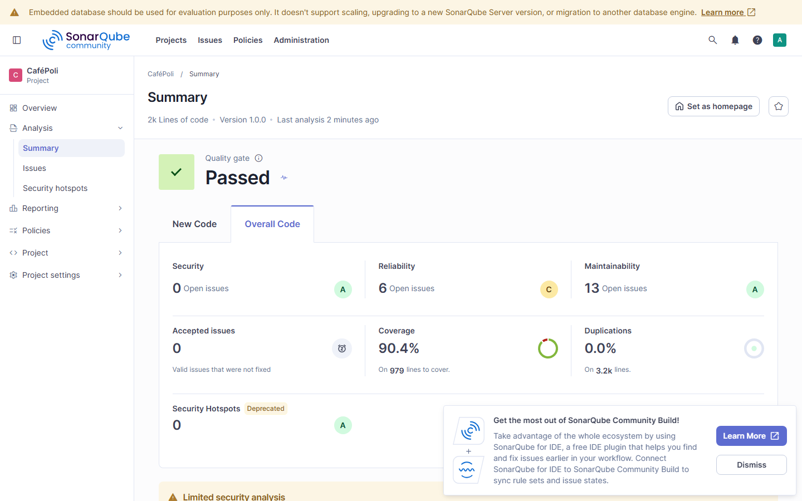
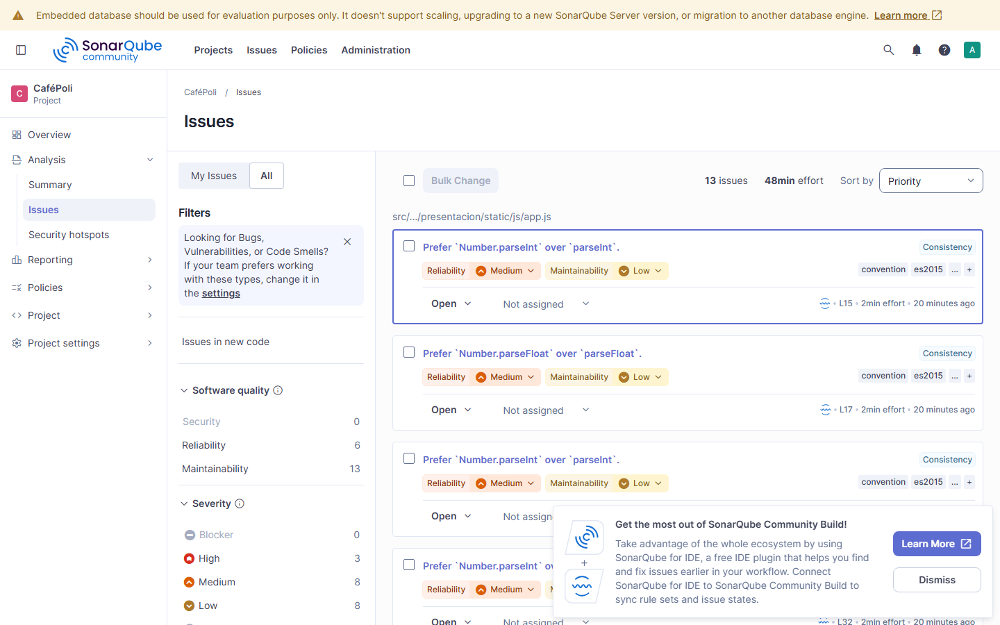
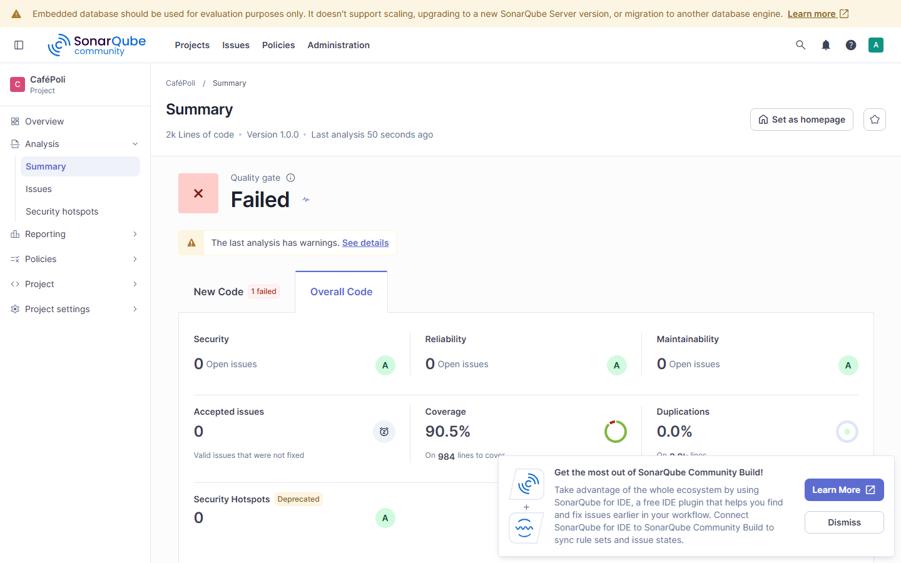
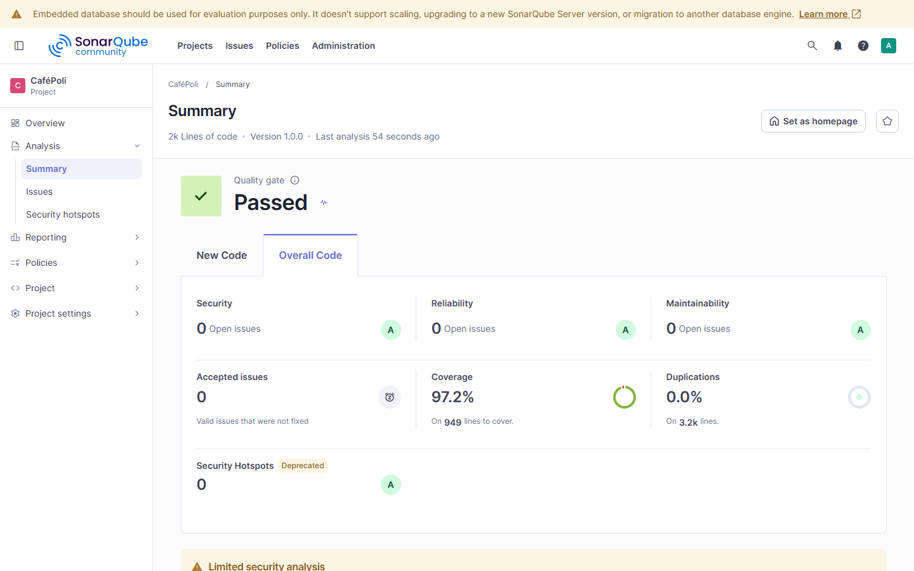
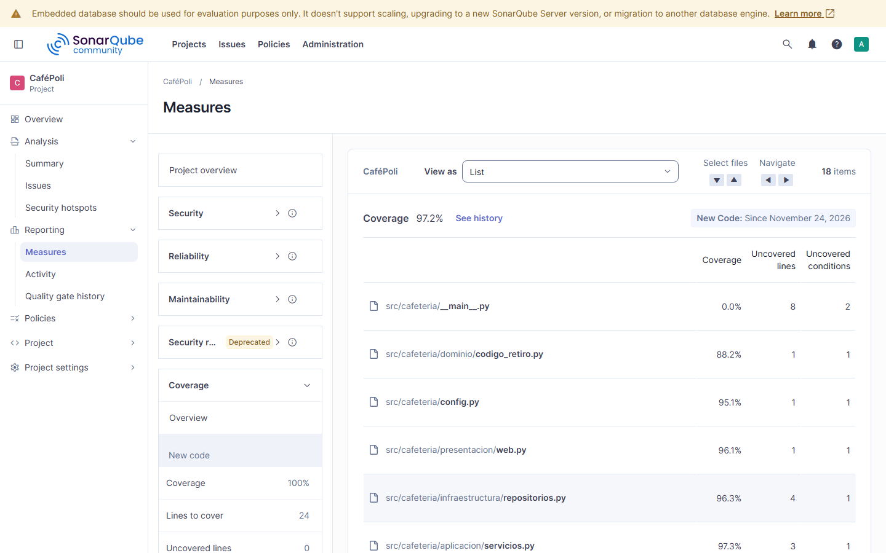

# 5. Reporte de análisis estático del código

El análisis estático inspecciona el código sin ejecutarlo. Es uno de los principios de prueba de
Davis (Pressman [1], principio 7): las técnicas estáticas encuentran defectos que las pruebas no
ven. Se usaron dos herramientas:

- **Ruff 0.17.6** en cada commit y en la CI: estilo PEP 8, orden de *imports*, nombres, errores
  probables y modernización del código. Resultado: **sin observaciones** en la versión 1.0.0.
- **SonarQube Community Build 26.11** en Docker: mantenibilidad, confiabilidad, seguridad,
  duplicación, complejidad, cobertura y Quality Gate. Se hicieron tres análisis.

## 5.1 Configuración

Se siguió el procedimiento de la tarea TG3:
- SonarQube corre en un contenedor de la red `net-sonar`, con volúmenes nombrados para los datos,
  los complementos y los registros.
- El escáner (`sonarsource/sonar-scanner-cli` 8.5) se ejecuta en otro contenedor de la misma red.
- Las pruebas se ejecutan antes en un contenedor `python:3.12-slim`, para que las rutas del reporte
  de cobertura (`coverage.xml`) coincidan con las del escáner.

| Parámetro | Valor | Motivo |
|---|---|---|
| Perfil de calidad de Python | **Sonar way comprehensive** (407 reglas) | El perfil por defecto, *Sonar way core*, tiene 232 reglas. En TG3 se vio que el perfil cambia por completo el resultado, así que se eligió el más exigente |
| Perfiles de HTML, CSS y JavaScript | Por defecto | Las plantillas, la hoja de estilos y el script también se analizan |
| Quality Gate | *Sonar way*: código nuevo sin problemas, cobertura ≥ 80 % y duplicación ≤ 3 % | Se evalúa sobre el código nuevo, por lo que obliga a mejorar en cada cambio |
| `sonar.sources` / `sonar.tests` | `src` / `tests` | Las pruebas no cuentan como líneas de producto |
| `sonar.coverage.exclusions` | `static/js/**` | El JavaScript es mejora progresiva y se verifica con CT-M01 (ADR-008) |

Archivo: [`sonar-project.properties`](../../sonar-project.properties). Datos crudos de cada
análisis: [`sonar_v1.json`](sonar_v1.json), [`sonar_v2.json`](sonar_v2.json) y
[`sonar_v3.json`](sonar_v3.json).

## 5.2 Resultados

| Métrica | v1 (inicial) | v2 (tras corregir) | v3 (final, v1.0.0) |
|---|---|---|---|
| Quality Gate | ✅ Aprobado | ❌ **Rechazado** | ✅ Aprobado |
| Problemas abiertos | 13 | 0 | 0 |
| Calificación de seguridad | A (0) | A | A |
| Calificación de confiabilidad | **C (6)** | A | A |
| Calificación de mantenibilidad | A (13) | A | A |
| Deuda técnica | 48 min | 0 min | 0 min |
| Security hotspots | 0 | 0 | 0 |
| Cobertura total (líneas / ramas) | 90,4 % (91,4 / 83,6) | 90,5 % | **97,2 %** (97,8 / 93,6) |
| Cobertura del código nuevo | — | 75,9 % | 100 % |
| Duplicación | 0,0 % | 0,0 % | 0,0 % |
| Líneas de código | 2 001 | 2 014 | 2 014 (Python 1 403, HTML 393, CSS 169, JS 49) |
| Complejidad ciclomática / cognitiva | 294 / 155 | 295 / 155 | 295 / 155 |
| Pruebas | 104 | 104 | 113 |

SonarQube 26 usa el modelo de calidad MQR (*Multi-Quality Rule*): cada problema afecta a una o
varias cualidades (seguridad, confiabilidad, mantenibilidad) con una severidad. Por eso los 6
problemas del JavaScript bajan la confiabilidad a C aunque en el modelo antiguo eran solo *code
smells*.

*Figura 1. Análisis v1: Quality Gate aprobado, pero confiabilidad C y 13 problemas de mantenibilidad.*

*Figura 2. Lista de problemas del análisis v1.*

## 5.3 Problemas encontrados y correcciones

Cada corrección se asocia con la refactorización del catálogo de Fowler [3] (semana 4 [6]) que
resuelve el problema, salvo las dos que son prácticas propias del lenguaje.

| Regla | Cant. | Severidad / cualidad | Archivo | Problema | Corrección | Refactorización |
|---|---|---|---|---|---|---|
| javascript:S7773 | 6 | Media en confiabilidad, baja en mantenibilidad | `static/js/app.js` | `parseInt`/`parseFloat` globales | `Number.parseInt` y `Number.parseFloat` | Práctica de ECMAScript 2015 |
| python:S1192 | 3 | Alta en mantenibilidad | `rutas_cliente.py`, `rutas_personal.py` | Literales repetidos: `"/ingresar"` 4 veces, `"/personal"` 4 veces, `"/personal/menu"` 3 veces | Constantes `RUTA_INGRESO`, `RUTA_TABLERO`, `RUTA_INGRESO_PERSONAL`, `RUTA_MENU_PERSONAL` | *Replace Magic Literal* |
| python:S5778 | 1 | Media en mantenibilidad | `tests/integracion/test_servicios.py` | Dos llamadas que pueden lanzar la excepción dentro de un `pytest.raises` | Calcular el código del producto antes del bloque | *Extract Variable* |
| python:S5886 | 1 | Media en mantenibilidad | `infraestructura/repositorios.py` | `dataclasses.replace` devuelve un tipo genérico, no `Cliente` | Método `Cliente.con_identidad(id, codigo)` en la entidad | *Move Function* |
| python:S8409 | 2 | Baja en mantenibilidad | `presentacion/rutas_api.py` | `response_model` repite la anotación de retorno | Se quita el parámetro redundante | *Change Function Declaration* |

Las correcciones se hicieron en el PR [#6](../../../../pull/6). Las 104 pruebas siguieron pasando
después de cada cambio, como exige la definición de refactorización: cambiar la estructura sin
cambiar el comportamiento [3].

## 5.4 Hallazgo: el segundo análisis rechazó el Quality Gate

El análisis v2 dejó **0 problemas**, pero el Quality Gate pasó de aprobado a **rechazado**:

*Figura 3. Análisis v2: sin problemas abiertos, pero «New Code: 1 failed».*

| Condición del código nuevo | Umbral | Real | Estado |
|---|---|---|---|
| Problemas nuevos | 0 | 0 | ✅ |
| Duplicación | ≤ 3 % | 0,0 % | ✅ |
| **Cobertura** | ≥ 80 % | **75,9 %** | ❌ |

**Análisis.** El Quality Gate solo evalúa las líneas que cambiaron desde el análisis anterior.
Sin cubrir quedaron dos grupos:

| Archivo | Líneas nuevas | Sin cubrir | Causa |
|---|---|---|---|
| `static/js/app.js` | 5 | 5 | El JavaScript no tiene pruebas automáticas, así que SonarQube lo cuenta como no cubierto |
| `rutas_cliente.py` | 7 | 2 | Las redirecciones al ingreso de dos rutas (confirmar y ver pedido sin sesión) no tenían prueba |

El segundo grupo es un hallazgo real. La medición con `coverage` mostró además otras ramas de la
capa web sin probar: acciones del personal sin sesión, pedidos o productos inexistentes, errores al
editar un producto y rutas inexistentes de la API.

**Solución.**
1. Se agregaron **9 pruebas de sistema** para esas rutas. La cobertura de `rutas_personal.py` subió
   de 83 % a 100 %, y la total, de 93 % a 97 %.
2. Se excluyó `static/js/**` del cálculo de cobertura. La decisión queda justificada en
   `sonar-project.properties` y en ADR-008: el script es mejora progresiva, el servidor valida
   todas las reglas, y su comportamiento se verifica con el caso manual CT-M01. Agregar pruebas
   de JavaScript habría exigido Node.js solo para unas 60 líneas.

**Tercer análisis.** Quality Gate aprobado, cobertura del código nuevo 100 %. La primera ejecución
de v3 mostró la advertencia *«Missing blame information for 9 files»*: se había analizado con
cambios sin commit. Se repitió después del commit y quedó sin advertencias.

*Figura 4. Análisis v3, la línea base v1.0.0: Quality Gate aprobado, A en las tres cualidades, 97,2 % de cobertura.*

*Figura 5. Cobertura por archivo en el análisis v3.*

## 5.5 Conclusiones

- El código llegó al primer análisis con pocos problemas. Cuatro decisiones de diseño lo explican:
  capas, enumeraciones en lugar de texto, montos con `Decimal` y Ruff desde el primer commit.
- Aun así, SonarQube encontró problemas que Ruff no detecta: el reporte de tipos (S5886), los
  literales repetidos (S1192) y el JavaScript.
- Tal como pasó en TG3, **el segundo análisis es parte del proceso**. Corregir los problemas no
  bastó: el Quality Gate sobre el código nuevo reveló rutas sin prueba que el porcentaje total
  (90 %) ocultaba.
- No se marcó ningún problema como «aceptado» ni «falso positivo»: los 13 se corrigieron.
