# 8. Manual de usuario · CaféPoli 1.0.0

CaféPoli permite pedir en la cafetería antes de llegar y retirar el pedido con un código.

- [Para clientes](#para-clientes) (estudiantes y docentes): pedir desde el celular.
- [Para el personal de la cafetería](#para-el-personal-de-la-cafetería): atender los pedidos y
  mantener el menú.

Los estados de un pedido son siempre los mismos, con el mismo color e ícono para el cliente y para
el personal:

| Estado | Significa |
|---|---|
| 🟡 **Pendiente** | La cafetería recibió el pedido y todavía no lo prepara |
| 🔵 **En preparación** | Se está preparando |
| 🟢 **Listo para retirar** | Ya puedes acercarte al mostrador con tu código |
| ⚪ **Entregado** | El pedido se entregó |

---

## Para clientes

### 1. Ver el menú

Abre la dirección de CaféPoli en tu celular (pregunta en la cafetería). El menú muestra los
alimentos y las bebidas con su precio. Los productos que se acabaron aparecen tachados con la
etiqueta **No disponible**. Puedes ver el menú sin cuenta; para pedir necesitas ingresar.

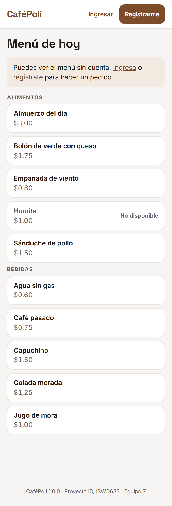

### 2. Crear tu cuenta (solo la primera vez)

Toca **Registrarme** y completa tu nombre, apellido, cédula, celular (09…) y correo institucional.
Al terminar verás tu código de cliente, por ejemplo `CLI-0001`, y ya podrás pedir.

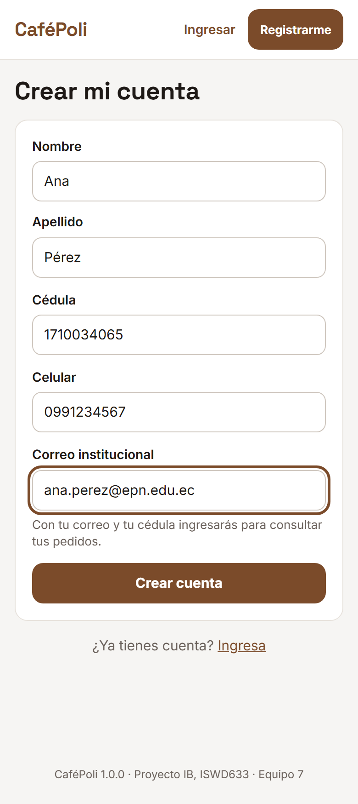

Las siguientes veces toca **Ingresar** y escribe tu correo institucional y tu cédula.

### 3. Armar tu pedido

Usa **+** y **−** junto a cada producto, o escribe la cantidad. Puedes pedir hasta 20 unidades de
cada producto. La barra de abajo muestra en todo momento cuántos artículos llevas y el total.
Cuando termines, toca **Revisar pedido**.

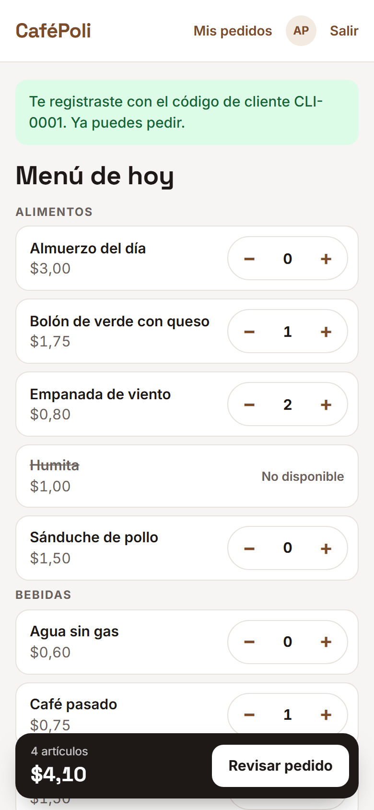

Si tocas **Revisar pedido** sin elegir nada, verás «El pedido debe incluir al menos un producto».

### 4. Revisar y confirmar

Revisa cada producto, su cantidad y el total. Si quieres cambiar algo, toca **‹ Seguir agregando**.
Si todo está bien, toca **Confirmar pedido**.

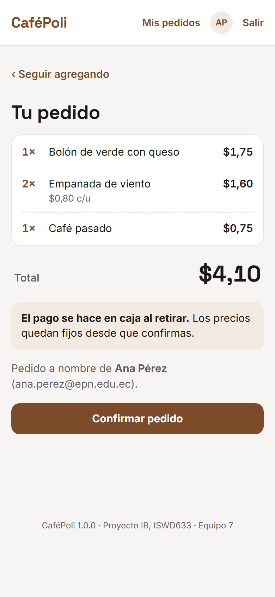

- El pago se hace en la caja al retirar; CaféPoli no cobra en línea.
- El precio queda fijo desde que confirmas, aunque después cambie en el menú.
- Si un producto se agota o cambia de precio mientras revisas, CaféPoli te avisa y no confirma
  hasta que veas el cambio.

### 5. Tu código de retiro

Al confirmar recibes un **código de retiro** como `K7P-4QX`. No usa letras ni números que se
confundan (0/O, 1/I/L). La pantalla muestra en qué etapa está tu pedido y se actualiza sola cada
20 segundos.

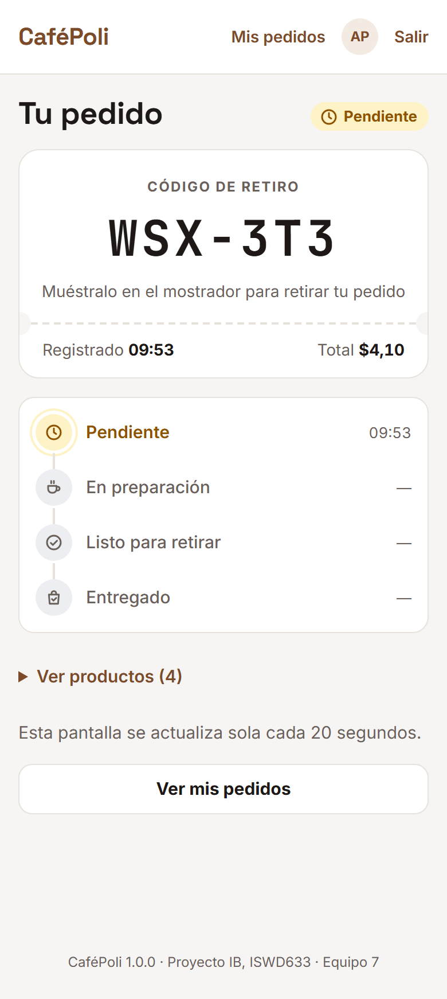 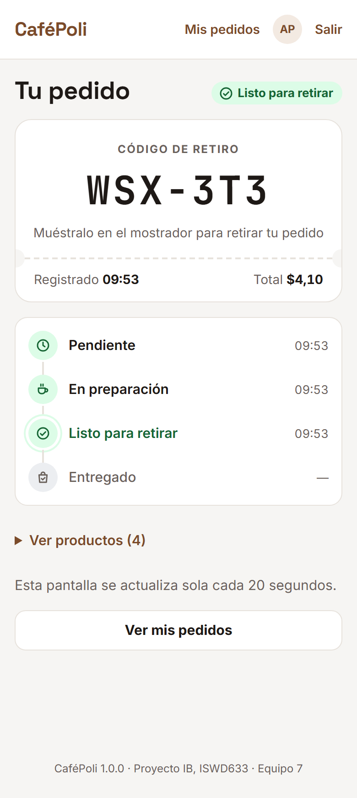

Cuando veas **Listo para retirar**, acércate al mostrador y muestra tu código.

### 6. Consultar tus pedidos

Toca **Mis pedidos** para ver todos tus pedidos, del más reciente al más antiguo, con su estado.
Toca uno para ver su código.

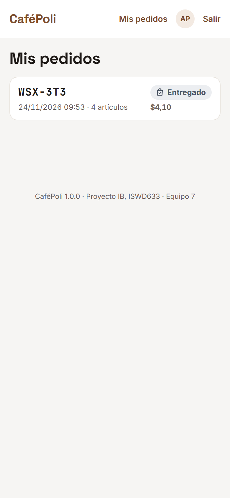

---

## Para el personal de la cafetería

Usa una computadora o tablet en el mostrador y abre `/personal` en la dirección de CaféPoli.

### 1. Ingresar

Escribe el usuario y la clave del personal (los configura quien instaló CaféPoli).

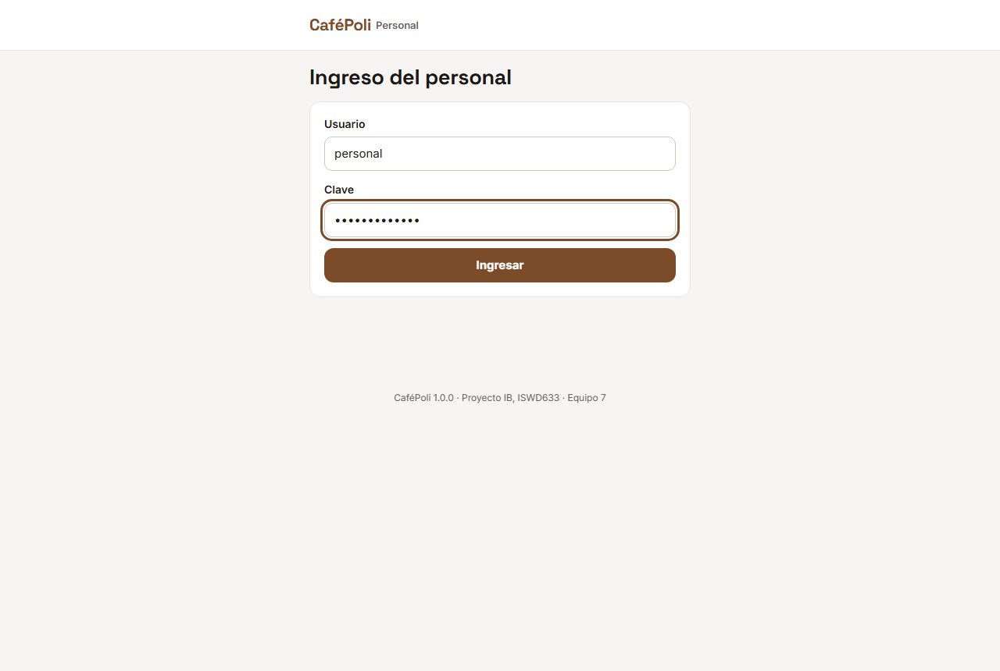

### 2. El tablero de pedidos

El tablero muestra los pedidos en tres columnas: **Pendiente**, **En preparación** y **Listo para
retirar**. En cada columna, el más antiguo está arriba. El resumen indica cuántos hay en cada estado
y cuántos se entregaron hoy. El tablero se actualiza solo cada 20 segundos, excepto mientras
escribes un código.

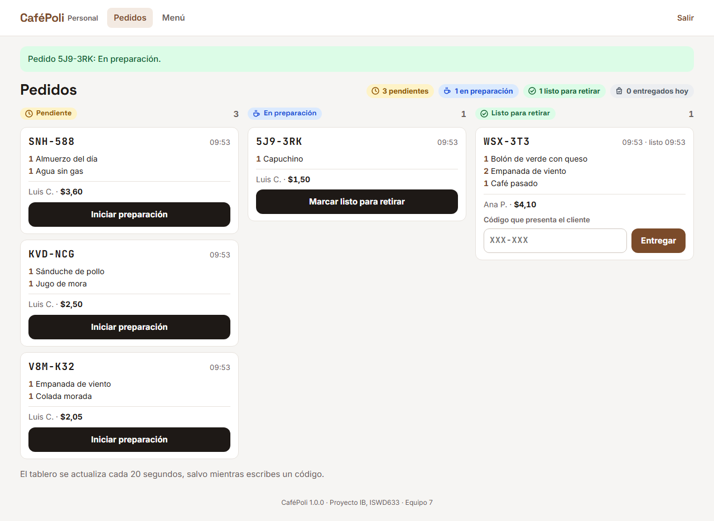

Cada tarjeta muestra el código, la hora, los productos con sus cantidades, el cliente y el total.

### 3. Atender un pedido

1. Toca **Iniciar preparación** en un pedido Pendiente: pasa a *En preparación*.
2. Cuando esté listo, toca **Marcar listo para retirar**. El cliente lo verá en su celular.

Los pedidos solo avanzan en ese orden y no se pueden cancelar en esta versión.

### 4. Entregar un pedido

Cuando llegue el cliente, pídele **su** código de retiro y escríbelo en la tarjeta del pedido. Da
igual si lo escribes con minúsculas, espacios o sin guion. Luego toca **Entregar**.

- Si el código **coincide**, verás «Pedido XXX-XXX entregado.» y el pedido sale del tablero.
- Si **no coincide**, el pedido no se entrega y sigue en Listo para retirar. Verifica el código con
  el cliente: puede que estés en la tarjeta equivocada.

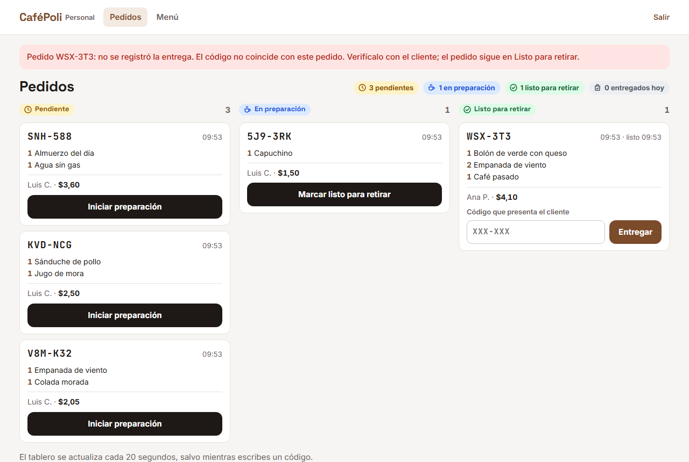

Escribe siempre el código que te muestra el cliente, no el que ves en la tarjeta: así se evita
entregar un pedido a otra persona.

### 5. Mantener el menú

En la pestaña **Menú** ves todos los productos con su código, categoría, precio y estado.

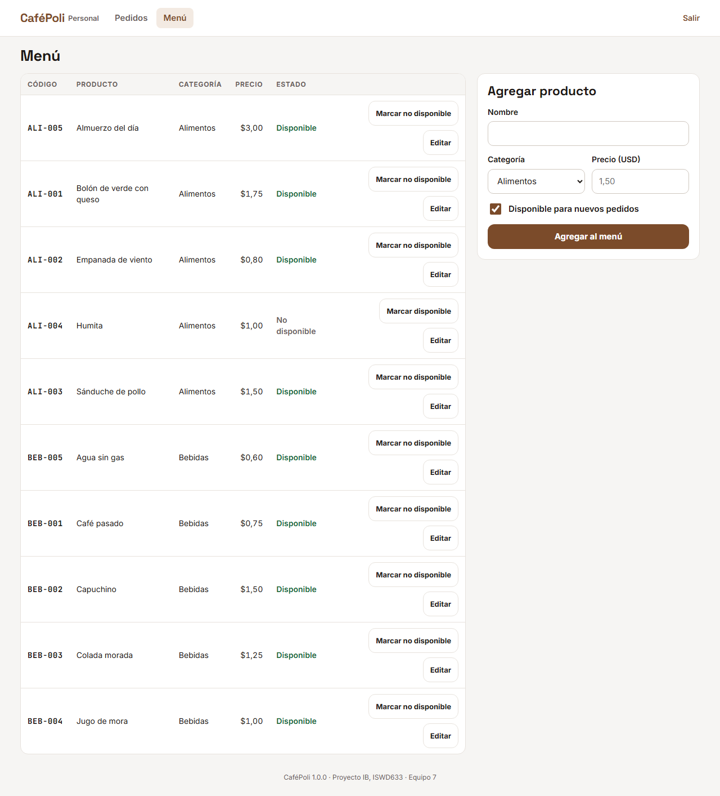

| Para | Haz esto |
|---|---|
| Agregar un producto | Completa el formulario «Agregar producto» (nombre, categoría y precio, por ejemplo `1,50`) y toca **Agregar al menú**. El código se asigna solo: `ALI-006`, `BEB-006`… |
| Avisar que algo se acabó | Toca **Marcar no disponible**; los clientes ya no podrán pedirlo. Para volver a ofrecerlo, toca **Marcar disponible** |
| Cambiar nombre, categoría o precio | Toca **Editar**, cambia los datos y toca **Guardar cambios** |

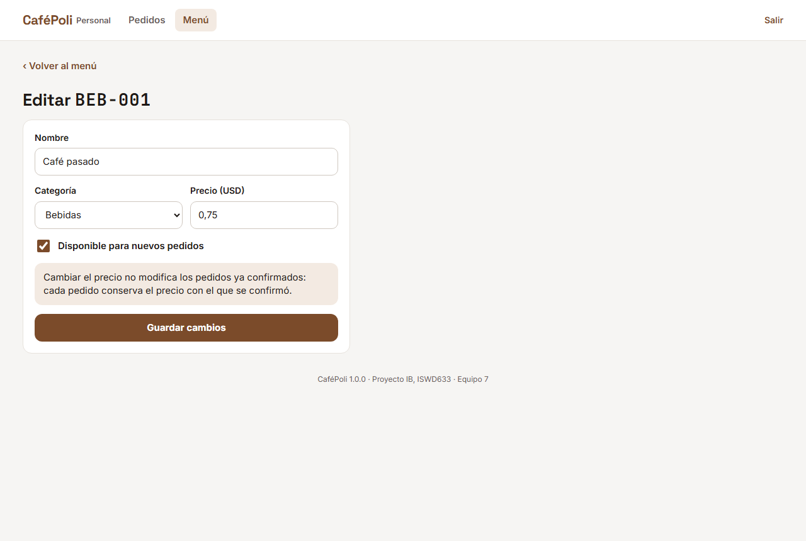

Cambiar un precio no afecta los pedidos que ya se confirmaron: cada pedido conserva el precio con
que se hizo. Los productos no se eliminan, para conservar el historial; se marcan como no
disponibles.

### 6. Salir

Toca **Salir** en la barra superior al terminar el turno.

---

## Preguntas frecuentes

| Pregunta | Respuesta |
|---|---|
| ¿Puedo cancelar un pedido? | No en esta versión. Si te equivocaste, avisa en el mostrador |
| ¿Cómo pago? | En la caja, al retirar. CaféPoli no cobra en línea |
| ¿Me llega una notificación cuando está listo? | No. Deja abierta la pantalla de tu pedido, que se actualiza sola, o revisa «Mis pedidos» |
| Dice «No encontramos un cliente con ese correo y esa cédula» | Revisa que el correo sea el institucional y la cédula tenga 10 dígitos. Si es tu primera vez, regístrate |
| Dice «Ya existe un cliente con esa cédula» al registrarme | Ya tienes cuenta: usa **Ingresar** |
| ¿Por qué no puedo pedir 25 empanadas? | El máximo es 20 unidades por producto; para más, haz otro pedido o avisa en el mostrador |
| Perdí mi código | Ingresa y ábrelo desde **Mis pedidos** |
